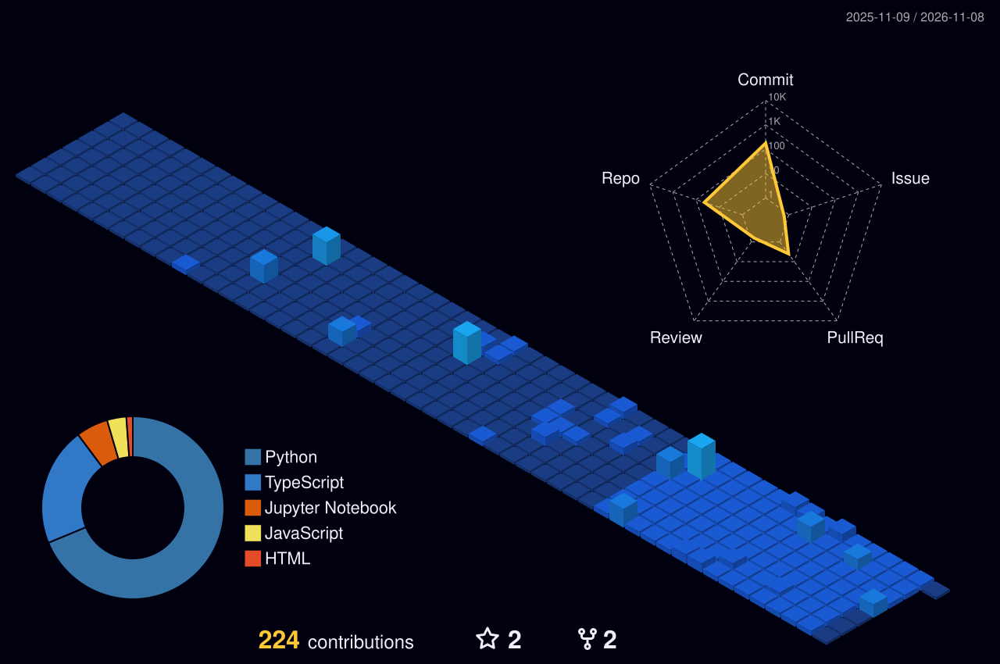

<!-- Animated cards are built by scripts/build_svgs.py. After editing an SVG, bump ?v= below (GitHub caches images hard). -->

  

  

  

  

## 🛠️ Featured projects

| Project | What it does | Stack |
| --- | --- | --- |
| [**Workflow-CI-V1**](https://github.com/amirullahh/Workflow-CI-V1) | CI/CD pipeline that trains, tracks and packages a House Prices ML model | GitHub Actions · MLflow · Python |
| [**hello-cloudbuild-app**](https://github.com/amirullahh/hello-cloudbuild-app) · [**env**](https://github.com/amirullahh/hello-cloudbuild-env) | GitOps-style CI/CD with separate app and environment repos | Google Cloud Build · Docker |
| [**cloudrun-progression**](https://github.com/amirullahh/cloudrun-progression) | Progressive rollouts of a containerised service on Cloud Run | Cloud Run · Docker |
| [**HCCDP-Cloud-Migration**](https://github.com/amirullahh/HCCDP-Cloud-Migration) | Cloud migration project from the Huawei Cloud developer track | Huawei Cloud · TypeScript |
| [**SmartRecruit_AI_V2**](https://github.com/amirullahh/SmartRecruit_AI_V2) | Applied NLP for screening and matching candidates | Python · NLP · Jupyter |
| [**openmusic-api-v2**](https://github.com/amirullahh/openmusic-api-v2) | RESTful music API with authentication and playlists | Node.js · REST |

## 🏙️ Contribution city

  

## 🤝 Let's connect

  

  
  
  

